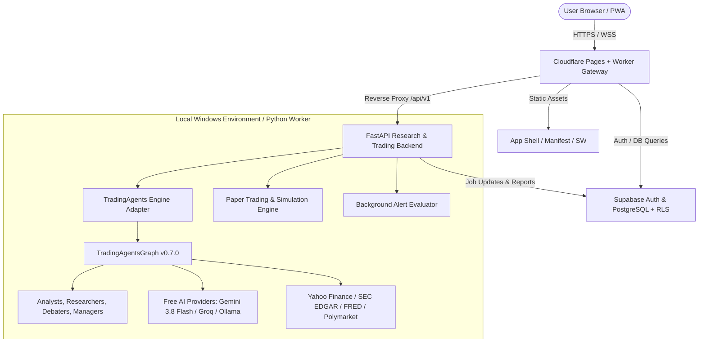

# TradingAgents PWA: System Design & Architecture (Phase 0)

## 1. System Overview & Principles

TradingAgents PWA transforms the upstream `TradingAgents` Python multi-agent financial research library into a modern, responsive, installable Progressive Web App (PWA) prioritizing free-first services and zero-monthly-hosting-cost deployment.

### Core Architectural Principles
1. **Engine Preservation**: Retain `TradingAgentsGraph` and upstream data flows unmodified. Interact strictly through typed adapter layers.
2. **Stateless Edge / Asynchronous Compute**: Cloudflare Pages / Workers handle edge traffic, static PWA hosting, route proxies, and rate limiting. Heavy multi-agent Python execution runs asynchronously on the user's local Windows PC (or any compatible compute instance), coordinated via Supabase and FastAPI.
3. **Defense-in-Depth Security**: Supabase PostgreSQL Row Level Security (RLS) on every user table; zero client secrets; privileged server role restricted to backend worker; live trading hard-disabled by default.
4. **Resilience & Honest State**: Offline caching of saved reports via Service Worker; explicit indicators for market data freshness and delayed quotes; no fabricated AI or financial predictions.



---

## 2. Frontend Architecture (React, TypeScript, Vite, PWA)

### 2.1 Technology Stack
- **Framework**: React 19 + TypeScript + Vite.
- **Styling**: Vanilla CSS Design System with dark-mode aesthetic, HSL color tokens, glassmorphism, responsive typography, and micro-interactions.
- **Charts**: Lightweight financial charts (Candlestick, Volume, Moving Averages, RSI/MACD indicators).
- **PWA Capabilities**:
  - `manifest.webmanifest`: App name, icons, standalone display mode, financial categorization.
  - Service Worker (`sw.ts`): Caches app shell, static assets, and non-expired research reports using Cache API & IndexedDB.
  - Safe Offline Support: Cached reports remain readable offline, clearly badged with synchronization timestamps and offline status indicators.

### 2.2 Key User Interface Views
1. **Market Dashboard (`/dashboard`)**:
   - Stocks & Crypto search, watchlists, live/delayed quotes, price sparklines, volume indicators, data freshness badges.
2. **Research Workspace (`/research`)**:
   - Analysis submission form (symbol, asset type, date, analyst team selection, model configuration).
   - Real-time job status tracker: `queued` → `running` (step-by-step agent activity) → `completed` / `failed`.
   - Comprehensive multi-agent report viewer: Analyst reports, Bull/Bear debate transcript, Risk manager discussions, Trader plan, and Portfolio Manager 5-tier recommendation.
   - Export actions: One-click export to Markdown, HTML, JSON, and CSV.
3. **Paper Portfolio & Ledger (`/portfolio`)**:
   - Holdings table, cash balance, realized/unrealized P&L, simulated order placement (Buy/Sell, Market/Limit).
   - Historical equity curve and transaction ledger.
4. **Backtesting Lab (`/backtest`)**:
   - Historical grid sweep configurator, benchmark selection, hit-rate statistics, and alpha return distributions.
5. **Alerts Center (`/alerts`)**:
   - Rule builder (price target, percentage change over window), trigger history, in-app notifications.
6. **Admin Panel (`/admin`)**:
   - User quotas, job queue health, API provider allowlists, and security audit logs.

---

## 3. Hosting & Gateway Architecture (Cloudflare)

### 3.1 Cloudflare Pages
- Builds and serves the static React PWA assets on Cloudflare's global CDN (Free Tier).
- Custom headers for PWA caching: `Cache-Control: public, max-age=31536000, immutable` for hashed assets; `no-cache` for `index.html` and `sw.js`.

### 3.2 Cloudflare Worker Gateway (`cloudflare/worker.ts`)
- Serves as the single public entry point:
  - Route `/api/v1/*` proxied to the FastAPI Python service (via Cloudflare Tunnel / direct HTTPS endpoint).
  - Rate limiting (e.g. 60 requests/minute per IP) using Cloudflare Free Rate Limiting or in-memory sliding window.
  - JWT Pre-validation: Validates Supabase JWT signature before proxying compute-intensive requests.
  - CORS and Security Headers: Strict CSP, HSTS, X-Frame-Options, X-Content-Type-Options.

---

## 4. Python Research & Trading Service (`backend/`)

### 4.1 Framework & Organization
- **FastAPI**: Asynchronous web framework with Pydantic v2 schemas and dependency injection.
- **Structure**:
  ```
  backend/
    app/
      main.py                  # FastAPI app factory, middleware, CORS
      config.py                # Pydantic Settings, environment loading
      auth/                    # Supabase JWT validator & RBAC dependencies
      api/
        v1/
          market.py            # Market data & quotes (Yahoo Finance/Alpha Vantage)
          research.py          # TradingAgentsGraph job submission & status
          portfolio.py         # Paper portfolio & order management
          backtest.py          # Backtest runner & metrics
          alerts.py            # Alert rules & triggers
          admin.py             # Admin metrics, quotas, and audit events
      engine/
        adapter.py             # TradingAgentsGraph wrapper & thread isolation
        job_manager.py         # In-memory + Supabase async job runner
        paper_trading.py       # Portfolio simulation engine with order ledger
        alert_evaluator.py     # Scheduled background price checker
      models/                  # Pydantic request/response schemas
  ```

### 4.2 Research Job Lifecycle & Worker Isolation
1. **Submission**: User submits `POST /api/v1/research/jobs`.
2. **Persistence**: Server inserts record into Supabase `research_jobs` table (`status="queued"`).
3. **Execution**: FastAPI background task (or Celery/RQ worker) spawns a thread running `TradingAgentsGraph.propagate()`.
4. **Heartbeat & Status**: The job updates Supabase at key milestone transitions (analysts completed, debate in progress, rating finalized).
5. **Idempotency & Checkpointing**: Reuses upstream `SqliteSaver` checkpointer so interrupted runs can be resumed.
6. **Completion**: Persists full markdown/HTML report and structured ratings to Supabase `research_reports` table (`status="completed"`).

---

## 5. Database Schema & Security Migrations (`supabase/`)

### 5.1 Tables & Entity Relationships
1. `profiles`: `id (UUID -> auth.users)`, `email`, `role ('user'|'operator'|'admin')`, `daily_job_quota`, `created_at`.
2. `watchlists`: `id`, `user_id`, `name`, `created_at`.
3. `watchlist_items`: `id`, `watchlist_id`, `symbol`, `asset_type ('stock'|'crypto')`, `sort_order`.
4. `portfolios`: `id`, `user_id`, `name`, `initial_cash`, `current_cash`, `currency`, `created_at`.
5. `positions`: `id`, `portfolio_id`, `symbol`, `asset_type`, `quantity`, `average_price`, `updated_at`.
6. `orders`: `id`, `portfolio_id`, `symbol`, `side ('buy'|'sell')`, `order_type ('market'|'limit')`, `quantity`, `price`, `status ('pending'|'filled'|'cancelled'|'rejected')`, `fees`, `created_at`.
7. `research_jobs`: `id`, `user_id`, `symbol`, `asset_type`, `trade_date`, `status ('queued'|'running'|'completed'|'failed'|'cancelled')`, `model_config`, `error_message`, `created_at`, `completed_at`.
8. `research_reports`: `id`, `job_id`, `user_id`, `symbol`, `rating`, `markdown_content`, `html_content`, `created_at`.
9. `backtest_runs`: `id`, `user_id`, `symbols`, `start_date`, `end_date`, `metrics`, `status`, `created_at`.
10. `alert_rules`: `id`, `user_id`, `symbol`, `condition ('above'|'below'|'pct_change')`, `threshold`, `is_active`, `cooldown_minutes`, `last_triggered_at`.
11. `notifications`: `id`, `user_id`, `title`, `message`, `is_read`, `created_at`.
12. `usage_ledger`: `id`, `user_id`, `action_type`, `tokens_used`, `estimated_cost_usd`, `created_at`.
13. `audit_events`: `id`, `actor_id`, `action`, `resource_type`, `resource_id`, `ip_address`, `details`, `created_at`.

### 5.2 Row Level Security (RLS) Policy Architecture
- Every user-owned table has RLS enabled (`ALTER TABLE ... ENABLE ROW LEVEL SECURITY`).
- Standard Policy:
  ```sql
  CREATE POLICY "Users can only access own data" ON watchlists
  FOR ALL USING (auth.uid() = user_id) WITH CHECK (auth.uid() = user_id);
  ```
- Public profile read for admins only; profile self-updates restricted (cannot escalate `role` or `daily_job_quota`).
- Service role key used only within trusted backend server environment.

---

## 6. Live Trading Safety Architecture & Risk Controls

### 6.1 The Four Operational Tiers
1. **Tier 1: Research Only (Default)**: Outputs recommendations, analysis, and debate transcripts. No execution capabilities.
2. **Tier 2: Paper Trading**: Simulates orders, fills, slippage, and portfolio accounting using historical or delayed market feeds. No external broker contact.
3. **Tier 3: Broker Sandbox**: Places test orders against official exchange/broker paper sandbox environments (e.g. Alpaca Paper, Interactive Brokers Paper).
4. **Tier 4: Live Trading (Strictly Guarded)**: Real capital execution. Disabled in code and database by default.

### 6.2 Mandatory Safety Guards for Live Trading
- **Global Kill Switch**: Immediate cessation of all order submissions; best-effort cancellation of pending orders.
- **Explicit Administrator Opt-In**: Requires dual authorization (admin DB flag + backend config flag).
- **Hard Risk Limits**:
  - Max order notional limit ($1,000 default).
  - Max open positions limit (e.g. 5 positions max).
  - Daily loss limit (e.g. 2% portfolio max loss triggers automatic halt).
- **Order Preview & Idempotency**:
  - Two-stage confirmation dialog in frontend displaying side, quantity, estimated cost, and risk threshold checks.
  - Unique idempotency UUID per order to prevent duplicate fills on network timeouts.
- **Fail-Closed Principle**: If market data is stale (>60s), broker connection drops, or risk limits cannot be verified, all trading operations fail closed.

---

## 7. Cost Controls & Zero-Cost Deployment Blueprint

### 7.1 Free Tier Allocation
- **Frontend Hosting**: Cloudflare Pages (Free, unlimited bandwidth).
- **API Gateway**: Cloudflare Worker (Free tier: 100,000 requests/day).
- **Database & Auth**: Supabase Free Tier (500 MB database, 50,000 monthly active users, 2 GB file storage).
- **Compute / Research Engine**: User's local Windows PC (zero cloud compute costs, unmetered multi-agent execution).
- **Market Data**: Yahoo Finance + SEC EDGAR + FRED (100% free, no credit card).
- **AI Models**: Google Gemini 3.8 Flash / Gemini 3.5 Flash Lite (generous free rate limit tier), Groq Free Tier, or local Ollama (100% free).

### 7.2 Quota & Circuit Breaker Enforcement
- Daily user job quota (e.g. 10 deep research runs/day on free tier).
- Maximum execution timeout (180s per research job) to avoid hanging processes.
- LLM Token budget cap (`TRADINGAGENTS_MAX_TOKENS=8192`) and SDK retry bounds (`TRADINGAGENTS_LLM_MAX_RETRIES=3`).
